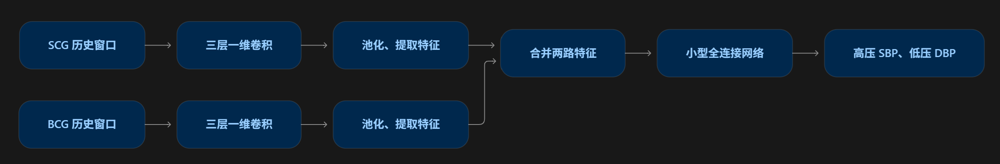

# DESCRIPTION

## PROJECT NAME

NIBPM(Non-invasive Blood Pressure Measurement/Monitoring)

This is a project aiming to measure blood pressure non-invasively, using BCD and SCG signal

# FIRST VERSION

SCG, BCG signal in last 10s -> a pair of SBP（收缩压） and DBP（舒张压）

## 模型结构:



| 部分       | 起始设计                         |
|:-----------|:---------------------------------|
| 每路编码器 | 三层 Conv1D，通道数 16 → 32 → 64 |
| 特征压缩   | 池化后，每路得到 512 维特征      |
| 两路融合   | 拼接成 1024 维                   |
| 预测部分   | 1024 → 64 → 血压输出             |
| 输出约束   | 保证预测高压大于低压             |

## 数据接口：

SCG：[样本数, SCG通道数, 1000]
BCG：[样本数, BCG通道数, 1000]
标签：[样本数, 2]，依次为高压、低压

保存成data.npz

scg        float32 [N, Cs, T]
bcg        float32 [N, Cb, T]
y          float32 [N, 2]，严格依次为 SBP、DBP，单位 mmHg
subject_id 整数数组或 Unicode 字符串数组 [N]，不要用 Python object 数组
fs         标量，共同采样率 Hz

数据保存写法（数组应来自未来的真实数据转换流程）：

```python
import numpy as np
np.savez_compressed('data.npz',
    scg=scg.astype(np.float32), bcg=bcg.astype(np.float32),
    y=bp.astype(np.float32), subject_id=subject_id.astype(str),
    fs=np.array(100.0))
```

### .npz 是什么格式的数据?

`*.npz` 是用来保存多个numpy数组的文件类型, 例如下面这样

```
data.npz
├── scg          SCG信号数组
├── bcg          BCG信号数组
├── y            高压、低压标签
├── subject_id   每条样本属于哪个受试者
└── fs           采样率
```

## 训练

```powershell
.venv\Scripts\python.exe train.py data.npz --epochs 100 --checkpoint best_bp.pt
```

## 推理和每秒更新

```python
from predict import Predictor
predictor = Predictor('best_bp.pt')
# scg_window / bcg_window: 已按训练方案预处理的 [C,T] 历史窗口
result = predictor.predict(scg_window, bcg_window, fs=100)
print(result)  # {'SBP': ..., 'DBP': ...}
```

不同人分别采集数据， 刚开始训练看模型效果的时候可以重复使用同一个人的数据， 后面在实际测试的时候应该保证同一个人不同时出现在训练集和测试集
